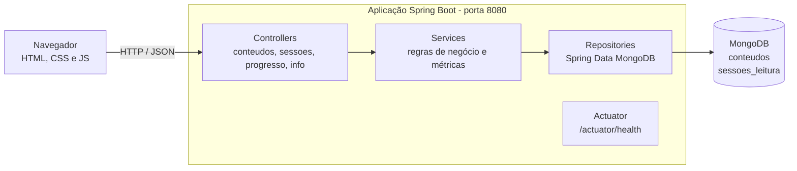

# FocusLeaf

**Leitura com foco. Aprendizado de verdade.**

Booktech educacional que divide textos longos em blocos curtos, apresenta um bloco por vez e mede o foco do estudante durante a leitura.

Projeto acadêmico — FIAP, turma 2TDS, Startup One, 2026.

---

## Sumário

1. [Sobre o projeto](#sobre-o-projeto)
2. [Relação com ESG](#relação-com-esg)
3. [Integrantes](#integrantes)
4. [O que a aplicação faz](#o-que-a-aplicação-faz)
5. [Tecnologias](#tecnologias)
6. [Arquitetura](#arquitetura)
7. [Pré-requisitos](#pré-requisitos)
8. [Variáveis de ambiente](#variáveis-de-ambiente)
9. [Como executar localmente (sem Docker)](#como-executar-localmente-sem-docker)
10. [API](#api)
11. [Health check e identificação do ambiente](#health-check-e-identificação-do-ambiente)
12. [Testes](#testes)
13. [Notas para containerização e pipeline](#notas-para-containerização-e-pipeline)
14. [Seções a completar pelo grupo](#seções-a-completar-pelo-grupo)
15. [Limitações conhecidas do MVP](#limitações-conhecidas-do-mvp)
16. [Estrutura do projeto](#estrutura-do-projeto)

---

## Sobre o projeto

Estudantes, principalmente universitários e alunos de EAD, consomem cada vez mais conteúdo digital longo. Esses materiais costumam ser estáticos e competem com abas, aplicativos e notificações pela atenção de quem lê.

Na pesquisa de validação do MVP, feita com 56 estudantes e leitores habituados a conteúdo digital:

- 82% afirmaram abandonar textos longos;
- 76% disseram se distrair com abas e notificações;
- 68% afirmaram que teriam mais facilidade se o conteúdo fosse dividido e menos maçante.

A FocusLeaf responde a isso com uma leitura **segmentada, simples e focada**: o texto é dividido em blocos, o leitor vê um bloco de cada vez e cada sessão registra o tempo de leitura, o ponto de abandono e a velocidade.

## Relação com ESG

A FocusLeaf se relaciona com o pilar **Social** do ESG, pela educação e pelo bem-estar digital de estudantes. A proposta se aproxima do **ODS 4 — Educação de Qualidade**, ao buscar tornar a leitura de materiais de estudo mais acessível e menos cansativa.

Algumas escolhas do MVP seguem essa direção: a leitura em blocos curtos, a tipografia pensada para leitura longa em tela, o modo escuro automático e o ajuste do tamanho do texto.

Este projeto é um MVP acadêmico. Ele não tem certificações, parcerias institucionais nem impacto educacional medido; esses pontos fazem parte da visão de produto, não de resultados alcançados.

## Integrantes

| Nome | Papel |
|---|---|
| João Felipe | Produto e Estratégia |
| Felipe Satler | Desenvolvimento |
| Gustavo Fatarelli | Tecnologia e Dados |
| Victoria Brambilla | Operações e Growth |

## O que a aplicação faz

**Conteúdos em blocos**
- Cadastrar, listar, consultar, editar e excluir textos.
- Cada texto é dividido em blocos, numerados automaticamente na ordem em que chegam.
- Cada bloco informa a quantidade de palavras e o tempo estimado de leitura (200 palavras por minuto).

**Leitura bloco a bloco (Modo Foco)**
- Um bloco por vez, com navegação para o anterior e o próximo.
- Durante a leitura, a interface esconde os elementos que não são o texto.

**Sessões de leitura e métricas de foco**
- Iniciar, concluir blocos, pausar e retomar, ou encerrar uma sessão.
- A sessão é concluída automaticamente quando todos os blocos são lidos.
- Cada leitor tem no máximo uma sessão aberta por texto.
- Métricas de cada sessão:
  - **tempo de leitura**;
  - **ponto de abandono**, o bloco em que o leitor parou;
  - **velocidade**, em palavras por minuto.
- Progresso acumulado de um leitor em um texto, somando todas as sessões.

**Interface web**
- Página servida pela própria aplicação, em `http://localhost:8080`.
- Lista de textos com o progresso, cadastro, leitura bloco a bloco e resumo de cada sessão.

**Fora do escopo do MVP:** login e senha (o leitor é identificado por um apelido), pagamentos, inteligência artificial, pausas inteligentes com repetição espaçada, painel para instituições e integração com plataformas de ensino.

## Tecnologias

- **Java 21** e **Spring Boot 4.1.1**
- **Spring Web MVC** para a API REST e a interface estática
- **Spring Data MongoDB** e **MongoDB**, local ou MongoDB Atlas
- **Bean Validation** para validar os dados recebidos
- **Spring Boot Actuator** para o health check
- **Maven** para o build
- **JUnit, Mockito, AssertJ e MockMvc** nos testes
- **HTML, CSS e JavaScript** sem frameworks na interface

## Arquitetura



**Coleções no MongoDB**

| Coleção | Conteúdo |
|---|---|
| `conteudos` | Título, autor, descrição e a lista de blocos, guardados dentro do próprio documento |
| `sessoes_leitura` | Leitor, conteúdo, status, blocos concluídos, palavras lidas, início, fim e ponto de abandono |

A organização do código é por funcionalidade:

| Pacote | Responsabilidade |
|---|---|
| `conteudo` | Textos e blocos |
| `sessao` | Sessões, métricas e progresso |
| `info` | Identificação da instância |
| `erro` | Tratamento padronizado de erros |
| `config` | Configurações gerais |

## Pré-requisitos

- **JDK 21**
- **Maven 3.9 ou superior**, ou uma IDE com suporte a Maven (VS Code com Extension Pack for Java, IntelliJ)
- **MongoDB**, que pode ser:
  - um cluster no MongoDB Atlas;
  - um MongoDB local na porta 27017;
  - um container: `docker run -d --name focusleaf-mongo -p 27017:27017 mongo:8`

## Variáveis de ambiente

| Variável | Obrigatória | Padrão | Descrição |
|---|---|---|---|
| `MONGODB_URI` | Em staging e produção | `mongodb://localhost:27017/focusleaf` | String de conexão do MongoDB. Inclua o nome do banco antes do `?`. |
| `PORT` | Não | `8080` | Porta HTTP da aplicação. |
| `APP_AMBIENTE` | Não | `local` | Nome do ambiente exibido em `/api/info` e na interface (`local`, `staging`, `producao`). |
| `APP_COMMIT` | Não | `desconhecido` | Commit implantado, exibido em `/api/info`. |

**Para desenvolvimento local**, copie o `.env.example` para `.env` na raiz do projeto e preencha os valores. A aplicação lê esse arquivo automaticamente se ele existir.

A ordem de prioridade é:
1. variáveis de ambiente reais (Docker, pipeline, plataforma de hospedagem);
2. o arquivo `.env`;
3. os valores padrão.

> O arquivo `.env` contém a senha do banco e **nunca** deve ir para o Git, para o ZIP de entrega ou para dentro da imagem Docker. Ele já está no `.gitignore`.

## Como executar localmente (sem Docker)

1. Configure o banco: crie o `.env` a partir do `.env.example`, ou tenha um MongoDB local na porta 27017.
2. Inicie a aplicação:

   ```bash
   mvn spring-boot:run
   ```

   Pelo VS Code ou pelo IntelliJ, também dá para executar a classe `FocusLeafApplication`.
3. Aguarde as mensagens `Tomcat started on port 8080` e `Started FocusLeafApplication`.
4. Abra **http://localhost:8080** no navegador.

**Para gerar e executar o JAR:**

```bash
mvn -B package
java -jar target/focusleaf-0.1.0-SNAPSHOT.jar
```

## API

Todas as rotas usam JSON. O arquivo [`requisicoes.http`](requisicoes.http) traz exemplos prontos para a extensão REST Client do VS Code, incluindo os casos de erro.

### Conteúdos

| Método | Rota | Descrição | Sucesso |
|---|---|---|---|
| POST | `/api/conteudos` | Cadastra um texto com seus blocos | 201 + `Location` |
| GET | `/api/conteudos` | Lista os textos (resumo, sem o texto dos blocos) | 200 |
| GET | `/api/conteudos/{id}` | Detalha um texto com todos os blocos | 200 |
| PUT | `/api/conteudos/{id}` | Substitui os dados e todos os blocos | 200 |
| DELETE | `/api/conteudos/{id}` | Exclui um texto | 204 |
| GET | `/api/conteudos/{id}/blocos` | Lista os blocos | 200 |
| GET | `/api/conteudos/{id}/blocos/{ordem}` | Lê um bloco, com o anterior e o próximo | 200 |

Exemplo de cadastro:

```json
{
  "titulo": "Como a memória guarda o que estudamos",
  "autor": "Equipe FocusLeaf",
  "descricao": "Texto de exemplo.",
  "blocos": [
    { "titulo": "Atenção vem primeiro", "texto": "Antes de ser lembrada, uma informação precisa ser percebida." },
    { "texto": "Dividir o material em blocos menores cria pontos naturais de parada." }
  ]
}
```

### Sessões de leitura e progresso

| Método | Rota | Descrição | Sucesso |
|---|---|---|---|
| POST | `/api/sessoes` | Inicia uma sessão (`conteudoId` e `leitor`) no bloco 1 | 201 + `Location` |
| GET | `/api/sessoes/{id}` | Consulta a sessão com as métricas | 200 |
| GET | `/api/sessoes?leitor={apelido}&conteudoId={id}` | Lista as sessões do leitor (`conteudoId` é opcional) | 200 |
| POST | `/api/sessoes/{id}/blocos/{ordem}/concluir` | Marca um bloco como lido | 200 |
| POST | `/api/sessoes/{id}/abandonar` | Encerra a sessão e registra o ponto de abandono | 200 |
| GET | `/api/progresso?leitor={apelido}&conteudoId={id}` | Progresso acumulado do leitor no texto | 200 |
| GET | `/api/info` | Identificação da instância (ambiente, versão, commit) | 200 |

### Formato dos erros

| Status | Quando acontece |
|---|---|
| 400 | Dados inválidos, JSON malformado ou parâmetro ausente |
| 404 | Texto, bloco ou sessão inexistente |
| 409 | Conflito com o estado atual (por exemplo, sessão já encerrada ou outra sessão aberta para o mesmo leitor e texto) |

```json
{
  "status": 400,
  "erro": "Dados inválidos",
  "mensagem": "Um ou mais campos estão inválidos.",
  "caminho": "/api/conteudos",
  "dataHora": "2026-10-07T22:00:00Z",
  "campos": {
    "titulo": "O título é obrigatório"
  }
}
```

## Health check e identificação do ambiente

| Rota | Uso |
|---|---|
| `GET /actuator/health` | Estado da aplicação e do MongoDB (`UP` ou `DOWN`) |
| `GET /actuator/health/liveness` | A aplicação está viva |
| `GET /actuator/health/readiness` | A aplicação está pronta para receber tráfego |
| `GET /api/info` | Ambiente, versão e commit da instância |

Exemplo de resposta de `/api/info`:

```json
{ "aplicacao": "focusleaf", "ambiente": "staging", "versao": "0.1.0-SNAPSHOT", "commit": "a1b2c3d" }
```

O ambiente e a versão também aparecem no topo da interface. Assim, os prints de staging e de produção mostram qual instância está respondendo.

## Testes

```bash
mvn test
```

São **44 testes automatizados**:

| Classe | Tipo | O que verifica |
|---|---|---|
| `ConteudoServiceTest` | Unitário (Mockito) | Numeração dos blocos, edição, exclusão, navegação entre blocos |
| `ConteudoControllerTest` | Camada web (MockMvc) | Status HTTP, validação, erros 400 e 404 |
| `SessaoServiceTest` | Unitário (relógio fixo) | Início, conclusão automática, abandono, regra de uma sessão aberta, progresso |
| `SessaoControllerTest` | Camada web (MockMvc) | Rotas de sessão e progresso, erros 400 e 409 |
| `EstimativaLeituraTest`, `MetricasLeituraTest` | Unitário | Contagem de palavras, tempo estimado, duração, velocidade, percentual |
| `InterfaceWebTest` | Camada web (MockMvc) | Interface e `/api/info` servidos pela aplicação |
| `InfoControllerTest` | Unitário | Identificação da instância |
| `FocusLeafApplicationTests` | Contexto completo | A aplicação inicializa sem erros de configuração |

Os testes de serviço e de controller simulam o banco, então **não gravam dados no MongoDB**.

O teste de contexto inicializa a aplicação completa. O driver do MongoDB conecta sob demanda, por isso esse teste não deve exigir um banco acessível. Vale confirmar isso na primeira execução do pipeline.

## Notas para containerização e pipeline

Informações para quem for montar o Docker, o Compose e o pipeline:

**Build e execução**
- **Build:** `mvn -B package` gera `target/focusleaf-0.1.0-SNAPSHOT.jar`. Use `mvn -B verify` ou `mvn -B test` para que o pipeline falhe quando algum teste falhar.
- **Execução:** `java -jar focusleaf-0.1.0-SNAPSHOT.jar`. A imagem precisa de um JRE 21.
- **Porta:** 8080 por padrão, ou o valor de `PORT`.

**Configuração**
- **Banco:** passe a URI pela variável `MONGODB_URI`.
  - No Docker Compose, com um serviço chamado `mongo`: `MONGODB_URI=mongodb://mongo:27017/focusleaf`.
  - Em staging e produção, use **bancos ou usuários separados**, por exemplo `focusleaf_staging` e `focusleaf_prod`, com secrets distintos.
- **Identificação:** defina `APP_AMBIENTE` (`staging` ou `producao`) e `APP_COMMIT` (o SHA do commit) em cada deploy.

**Verificação**
- **Health check:** `/actuator/health` pode ser usado no `HEALTHCHECK` do Docker, no `healthcheck` do Compose e no smoke test pós-deploy. Para checar só o processo, sem depender do banco, use `/actuator/health/liveness`.
- **Smoke test sugerido:** `/actuator/health` deve retornar `UP` e `/api/info` deve mostrar o `ambiente` esperado.

**Cuidados**
- **`.dockerignore`:** inclua `.env`. A aplicação lê um arquivo `.env` da pasta de trabalho se ele existir; se esse arquivo for copiado para a imagem, a senha local vai junto e passa a valer dentro do container.
- **Fontes:** a interface carrega as fontes do Google Fonts. Sem internet, o navegador usa fontes do sistema e tudo continua funcionando.

## Seções a completar pelo grupo

> Estas seções dependem da containerização, do pipeline e dos deploys. Devem ser preenchidas somente com o que foi realmente implementado e testado.

### Como executar localmente com Docker

_A completar._

### Pipeline CI/CD

_A completar: ferramenta, gatilhos, jobs e etapas._

### Containerização

_A completar: Dockerfile e estratégia de imagem._

### Orquestração

_A completar: Docker Compose ou Kubernetes, com volumes, redes e variáveis._

### Ambientes de staging e produção

| Ambiente | URL | Banco |
|---|---|---|
| Staging | _a definir_ | _a definir_ |
| Produção | _a definir_ | _a definir_ |

### Prints do funcionamento

_A completar._

### Desafios encontrados e soluções

_A completar._

### Checklist de entrega

- [ ] Projeto compactado em ZIP com estrutura organizada
- [ ] Dockerfile funcional
- [ ] docker-compose.yml ou arquivos Kubernetes
- [ ] Pipeline com etapas de build, teste e deploy
- [ ] README.md com instruções e prints
- [ ] Documentação técnica com evidências em PDF ou PPT
- [ ] Deploy realizado em staging
- [ ] Deploy realizado em produção
- [ ] URLs dos dois ambientes testadas
- [ ] Nenhum segredo incluído no ZIP, README, prints ou histórico recente
- [ ] ZIP final aberto e conferido antes do upload

## Limitações conhecidas do MVP

- **Sem login.** O leitor é identificado só por um apelido, guardado em minúsculas, sem senha.
- **Modo Foco limitado à página.** Ele reduz os elementos da própria interface; não bloqueia notificações nem outros aplicativos do dispositivo.
- **Histórico preservado.** Ao excluir um texto, as sessões de leitura dele continuam guardadas.
- **Edição de blocos durante uma leitura.** Editar os blocos de um texto com uma sessão aberta pode deixar as métricas dessa sessão inconsistentes.

## Estrutura do projeto

```
focusleaf/
├── pom.xml
├── README.md
├── .env.example                  # modelo das variáveis (sem segredos)
├── .gitignore
├── requisicoes.http              # exemplos de requisições (REST Client)
└── src/
    ├── main/
    │   ├── java/br/com/fiap/focusleaf/
    │   │   ├── FocusLeafApplication.java
    │   │   ├── config/           # relógio da aplicação
    │   │   ├── conteudo/         # textos e blocos (+ dto/)
    │   │   ├── sessao/           # sessões, métricas e progresso (+ dto/)
    │   │   ├── info/             # GET /api/info
    │   │   └── erro/             # exceções e respostas de erro
    │   └── resources/
    │       ├── application.properties
    │       └── static/           # interface: index.html, css/, js/
    └── test/java/br/com/fiap/focusleaf/   # 44 testes
```
